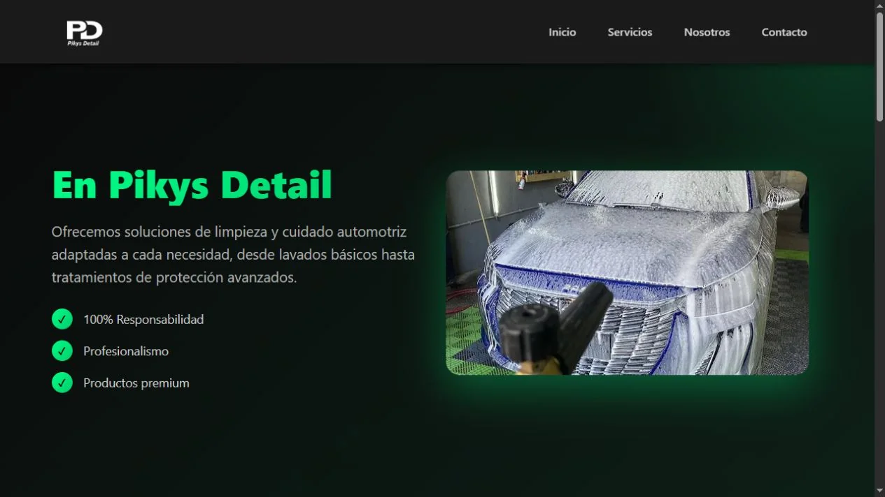
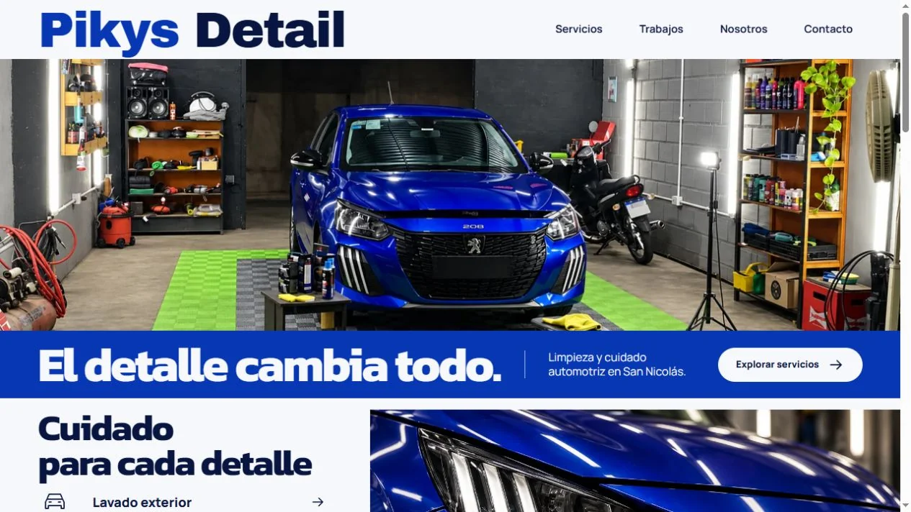
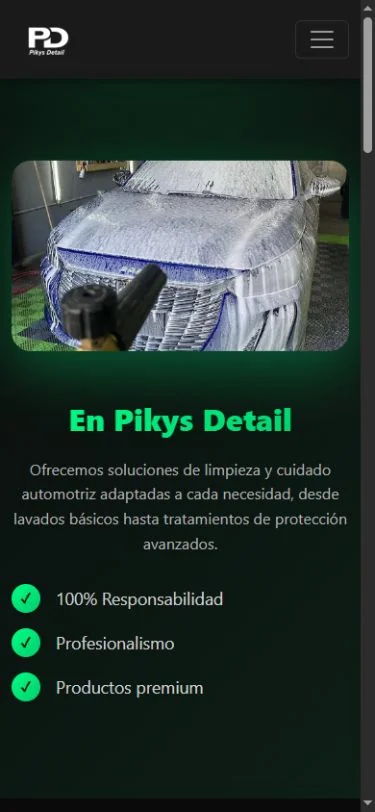
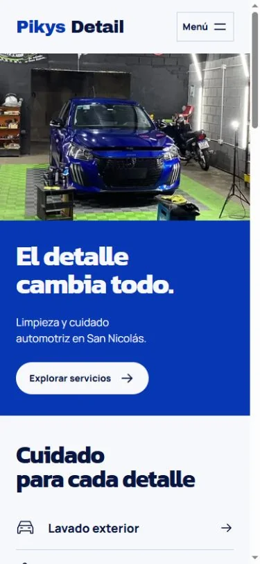

# Pikys Detail: de sitio inicial a landing de portfolio

## Objetivo

Refactorizar un sitio de cuidado automotriz en una landing que muestre diseño frontend, arquitectura proporcionada, accesibilidad y rendimiento. Se conservó el nombre Pikys Detail y el carácter familiar del emprendimiento. El contacto es una demostración visual explícita, sin envío ni reservas.

## Antes y después

Las capturas de antes proceden del commit original `7b61d54`, servido en una copia aislada. Las de después corresponden al build final. Las comparaciones de apertura usan los mismos tamaños: escritorio 1280×720 y móvil 390×844; la anchura visible excluye la barra de desplazamiento.

### Escritorio

Antes:

Después:

### Móvil

Antes:

Después:

## Decisiones

- Una fotografía panorámica y una franja cobalto sustituyen el hero dividido oscuro. Archivo Black, Kanit y Manrope aportan una voz tipográfica local y consistente.
- Una sola página reúne servicios, trabajos, historia y contacto. Los servicios utilizan `details` nativos, y el menú móvil añade únicamente el JavaScript necesario.
- El contacto informa de su alcance antes de los campos, que están deshabilitados. Se retiraron el código de envío heredado, los enlaces de ejemplo y las dependencias de CDN.
- La portada muestra la fotografía original del taller; el detalle ilustrativo del faro se distingue del material original del negocio. No se añaden reseñas, cifras comerciales ni resultados ficticios.
- HTML conserva el contenido; Vite procesa los recursos. pnpm, dependencias exactas y un único lockfile mantienen una instalación reproducible.

## Rendimiento medido

La comparación de rendimiento comienza en la landing ya rediseñada del commit `46f595a`, antes de optimizar los recursos. No representa una medición del sitio original de las capturas de antes.

| Métrica móvil | Antes de optimizar | Entrega final |
| --- | ---: | ---: |
| Lighthouse rendimiento | 68 | 96 |
| Accesibilidad automática | 100 | 100 |
| Buenas prácticas | 100 | 100 |
| SEO | 92 | 100 |
| LCP de laboratorio | 29,1 s | 2,7 s |
| CLS | 0,0055 | 0 |
| Transferencia medida | 5.522.112 B | 411.756 B |

WebP responsive, un recorte móvil equivalente al encuadre aprobado, variantes de la galería y fuentes WOFF2 completas reducen la transferencia medida en aproximadamente un 92,5 %. Escritorio Chrome y Edge obtienen 100 en las cuatro categorías.

Son mediciones locales de laboratorio con Lighthouse 13.5.0. Las puntuaciones pueden variar con el equipo y el hosting; la accesibilidad automática no sustituye una evaluación completa con personas y tecnologías de asistencia. La metodología y las comprobaciones están en [validación](validation.md) y los datos resumidos en [performance-results.json](performance-results.json).

## Entrega

Código estático preparado para Vercel, configuración de metadatos por dominio, pruebas de build y capturas de página completa: [escritorio](portfolio/landing-desktop.webp) y [móvil](portfolio/landing-mobile.webp). El despliegue lo realiza el propietario.

Actualización del 20/10/2026: portada e imagen social sustituidas por la fotografía original del taller. Las métricas de Lighthouse anteriores corresponden a la versión medida el 19/10/2026; no se volvieron a medir por este cambio de imagen. Las capturas de presentación se actualizan a la portada original.
